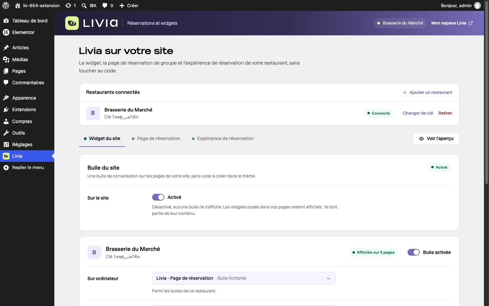
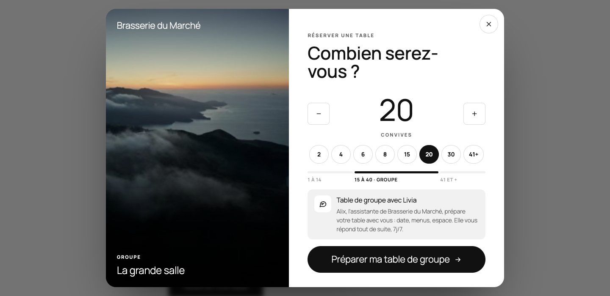

# Livia for WordPress

The WordPress plugin of [Livia](https://www.wearelivia.com), the hospitality platform for restaurants. It connects a
WordPress site to one or several restaurants' Livia spaces, so that the site can offer group booking and Livia's
conversational assistant without any code.



## What it does

- **Group booking page**: one real WordPress page per restaurant, at the address you choose, showing the
  restaurant's Livia group booking page with its assistant. The theme keeps its header and footer. Livia's content is
  cached and the last version received is kept when Livia cannot be reached. A visitor arriving with `?couverts=N`
  (1 to 999) starts the conversation with N guests.
- **Site widgets**: one Livia bubble per restaurant, on all pages, all pages but some, or only some. A page shows one
  bubble at most, never on a group booking page. Each page or post can keep, remove or change its bubble in the
  "Livia" panel of the editor.
- **Widgets in the content**: the "Livia widget" block, the "Livia" element of Elementor (3.5 or later), or the
  shortcode `[livia_widget widget="..."]` for the classic editor and other page builders.
- **Booking experience**: a window that asks for the number of guests (and the restaurant, when the site connects
  several) and leads the visitor to the right path for that restaurant: its booking tool for a small party, its Livia
  conversation or group booking page for a group, its contact or private hire tool for an event. The thresholds and
  paths are set per restaurant. Any link to `#reserver` or of class `livia-reserver` opens it, as do the "Book
  button" and "How many of you?" blocks and Elementor elements, and the shortcodes `[livia_reserver]` and
  `[livia_convives]`.



## Requirements

- WordPress 6.5 or later (tested up to 7.1)
- PHP 7.4 or later
- Permalinks other than "Plain"
- A Livia account with the WordPress connector turned on for each restaurant

## Installation

1. Download `livia-<version>.zip` from the [latest release](https://github.com/WeAreLivia/livia-wordpress/releases/latest).
2. In WordPress, go to Plugins > Add New Plugin > Upload Plugin, choose the zip, install and activate it.
3. In your Livia space, open the Connectors section, then the WordPress connector, and copy the restaurant's key
   (`lvwp_...`).
4. Open the **Livia** menu in WordPress, paste the key and click **Connect**. **Add a restaurant** connects another
   one.
5. In the **Site widget**, **Booking page** and **Booking experience** tabs, choose each restaurant's bubble and
   pages, the address of its booking page, and its thresholds and paths. Each tab saves on its own.

Deactivating the plugin turns the published group booking pages into drafts; activating it again publishes them
again. On a multisite network, a network-wide activation does so on every site, and a network-wide deactivation on
every site that has not also activated the plugin for itself. Removing a restaurant turns its page into a
draft. Deleting the plugin leaves the pages as drafts and removes its settings.

## Updates

Updates come through WordPress's standard update screen, served by Livia to sites presenting a valid restaurant key.
Each release zip carries an Ed25519 signature: the plugin installs a downloaded update only when the signature
matches the public key it embeds. See [SECURITY.md](SECURITY.md).

On a network where the plugin is active on sub-sites only, the network's update screen runs without the plugin, so
nothing would check the signature there: it lists the new version without a package. Download the new version's zip
from your Livia space or from the [latest release](https://github.com/WeAreLivia/livia-wordpress/releases/latest):
both carry the same signed zip, installed as in the Installation section.

## Configuration

The plugin calls the Livia service at `https://chat.booking.wearelivia.com`. A site can point it elsewhere in
`wp-config.php`:

```php
define( 'LIVIA_SERVICE_URL', 'https://...' ); // Address the WordPress server calls.
define( 'LIVIA_PUBLIC_URL', 'https://...' );  // Address visitors' browsers load scripts and previews from; defaults to LIVIA_SERVICE_URL.
```

## Local development

Tools: Node.js 24, Docker. PHP runs in the containers of
[`@wordpress/env`](https://developer.wordpress.org/block-editor/reference-guides/packages/packages-env/).

```bash
npm ci
npm run build                 # blocks, editor panel and booking window, from src/ to build/
npx wp-env start              # WordPress at http://localhost:8890 (admin / password)
npx wp-env run tests-cli --env-cwd=wp-content/plugins/livia-wordpress composer install
npx wp-env stop
npm run test:js               # decisions of the booking window, with Node's test runner
npm run zip                   # writes dist/livia-<version>.zip (after npm run build)
```

`.wp-env.json` runs WordPress 7.1 with PHP 8.3 and Elementor, and points the plugin to a Livia chat backend on
`localhost:3000`. To run the oldest supported versions, create a `.wp-env.override.json` (ignored by git) before
`npx wp-env start`:

```json
{ "core": "WordPress/WordPress#6.5-branch", "phpVersion": "7.4", "plugins": [ "." ] }
```

### Checks

```bash
# Coding standards (WordPress Coding Standards, PHP 7.4+ compatibility)
npx wp-env run tests-cli --env-cwd=wp-content/plugins/livia-wordpress vendor/bin/phpcs
# Unit tests
npx wp-env run tests-cli --env-cwd=wp-content/plugins/livia-wordpress vendor/bin/phpunit -c phpunit-unit.xml.dist
# Integration tests (Livia faked through the pre_http_request filter)
npx wp-env run tests-cli --env-cwd=wp-content/plugins/livia-wordpress vendor/bin/phpunit -c phpunit-integration.xml.dist
# Multisite, then with Elementor loaded
npx wp-env run tests-cli --env-cwd=wp-content/plugins/livia-wordpress env WP_MULTISITE=1 vendor/bin/phpunit -c phpunit-integration.xml.dist
npx wp-env run tests-cli --env-cwd=wp-content/plugins/livia-wordpress env LIVIA_TEST_ELEMENTOR=1 vendor/bin/phpunit -c phpunit-integration.xml.dist
```

The CI (`.github/workflows/ci.yml`) runs these checks under WordPress 6.5 with PHP 7.4 and WordPress 7.1 with
PHP 8.3 (the Elementor run under WordPress 7.1 only), and builds the zip.

### Translations

Source strings are in English; the French translation is `languages/livia-fr_FR.po`. With wp-env started and the
scripts built, `npm run i18n` updates `livia.pot` and `livia-fr_FR.po` and compiles the translations. Translate the new
entries, then run it again.

## Publishing a version

1. Set the new version in `livia.php` (the `Version` header and `LIVIA_VERSION`) and as `Stable tag` in `readme.txt`.
2. Merge to `main`, then push a tag `v<version>` on that commit.
3. The Release workflow (`.github/workflows/release.yml`) builds `livia-<version>.zip` in a job without any secret,
   then, in a second job that installs and builds nothing, checks the zip against the tag (`bin/check-zip.mjs`),
   signs it (`bin/sign-zip.mjs`) and attaches the zip and `livia-<version>.zip.sig` (its detached Ed25519 signature,
   base64) to the GitHub release of the tag. It stops at the first check that fails: `bin/check-zip.mjs` lists the
   zip checks and `bin/sign-zip.mjs` the reasons it refuses to sign.

The second job runs in the GitHub environment `release`, which only accepts the tags `v*` and requires a reviewer's
approval. The secret `LIVIA_WP_SIGNING_KEY`, the private key (the 32-byte Ed25519 seed in base64), is stored in that
environment only, never in the repository's secrets. The matching public key (32 bytes in base64) is
`Livia_Updater::SIGNING_KEY` in `includes/class-livia-updater.php`; the Livia update service verifies the releases
with the same public key, so change it there at the same time. If the seed is lost, no installed site accepts an
update signed with a new key. To generate a pair, run this on a trusted machine, outside CI and any shared or recorded
terminal. Put the seed in the secret `LIVIA_WP_SIGNING_KEY` of the `release` environment, and keep an encrypted
offline backup of it (a team password manager), never in the repository, in CI or in a shared terminal:

```bash
node -e "const k=require('crypto').generateKeyPairSync('ed25519');console.log('LIVIA_WP_SIGNING_KEY', k.privateKey.export({format:'der',type:'pkcs8'}).subarray(16).toString('base64'));console.log('SIGNING_KEY', k.publicKey.export({format:'der',type:'spki'}).subarray(12).toString('base64'))"
```

## Security

To report a vulnerability, see [SECURITY.md](SECURITY.md).

## License

Proprietary, provided to Livia's customers to run the plugin on their own WordPress sites. See [LICENSE](LICENSE).
